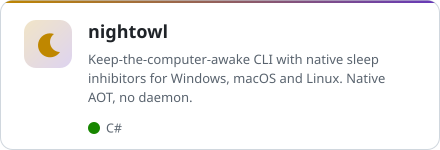
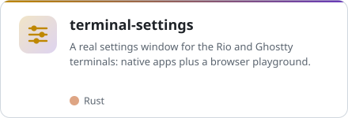
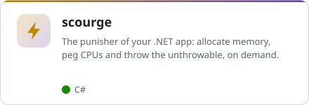
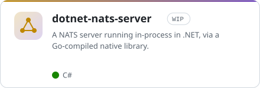
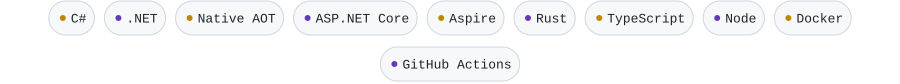

<picture>
  <source media="(prefers-color-scheme: dark)" srcset="assets/header-dark.svg">
  
</picture>

### Hi, I'm Niklas 👋

I build developer tooling and backend platforms, mostly in **C#/.NET** and lately **Rust**.
I like small, dependency-free tools that start instantly, compile to a single native binary,
and run the same on Windows, macOS and Linux.

### 🛠️ Things I've made

<table>
  <tr>
    <td width="50%">
      <a href="https://github.com/niklasfp/nightowl"><picture>
        <source media="(prefers-color-scheme: dark)" srcset="assets/card-nightowl-dark.svg">
        
      </picture></a>
    </td>
    <td width="50%">
      <a href="https://github.com/niklasfp/terminal-settings"><picture>
        <source media="(prefers-color-scheme: dark)" srcset="assets/card-terminal-settings-dark.svg">
        
      </picture></a>
    </td>
  </tr>
  <tr>
    <td width="50%">
      <a href="https://github.com/niklasfp/scourge"><picture>
        <source media="(prefers-color-scheme: dark)" srcset="assets/card-scourge-dark.svg">
        
      </picture></a>
    </td>
    <td width="50%">
      <a href="https://github.com/niklasfp/dotnet-nats-server"><picture>
        <source media="(prefers-color-scheme: dark)" srcset="assets/card-dotnet-nats-server-dark.svg">
        
      </picture></a>
    </td>
  </tr>
</table>

### 🧰 Usually reaching for

<picture>
  <source media="(prefers-color-scheme: dark)" srcset="assets/stack-dark.svg">
  
</picture>

### 📫 Elsewhere

𝕏 [@NiklFP](https://x.com/NiklFP) · 🦉 [nightowl site](https://niklasfp.github.io/nightowl/) · 🎛️ [terminal-settings playground](https://niklasfp.github.io/terminal-settings/) · 📍 Copenhagen, Denmark

The banner, cards and stack are hand-rolled SVGs generated by <code>node scripts/build.ts</code> from <code>scripts/profile.ts</code>. No third-party image services.
